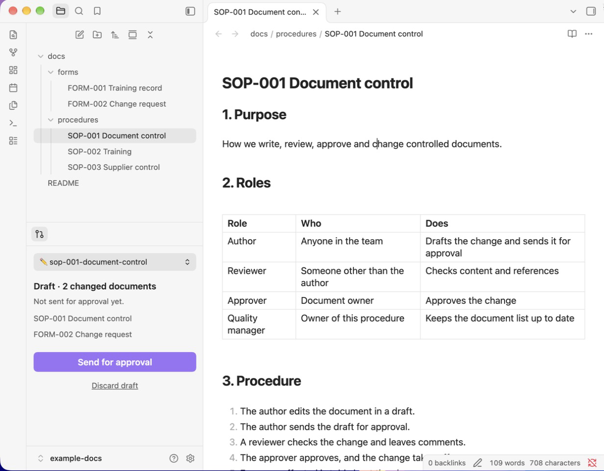

# Review Flow för Obsidian

*[English](README.md)*

Redigera Markdown-dokument i Obsidian och skicka ändringar för godkännande, utan att behöva kunna git.

Review Flow är till för team som har sina dokument i ett git-repo på GitHub och godkänner varje ändring med en pull request, till exempel styrda dokument i ett kvalitetsledningssystem. Den som skriver får en panel med en huvudknapp. Git och GitHub sköter resten i bakgrunden.



**Ny användare?** Följ [Kom igång](KOM-IGANG.md).

> **Status: prototyp (0.1).** Git-flödet har automatiska tester. Användargränssnittet i Obsidian är provat för hand men ännu inte brett testat.

## Så fungerar det

Review Flow lägger till panelen **Ändringar** i vänsterspalten. Det är det enda stället du behöver titta på:

- **Väljaren överst** visar var du är: *📖 Godkänd version* eller ett av dina utkast (*✏️ sop-001*). Välj ett annat utkast för att byta; det du står i sparas först. Utkast som väntar på godkännande visar det.
- **Ändrade dokument** listas under den. Klicka på ett för att öppna det.
- **En huvudknapp: Skicka för godkännande.** Den skickar utkastet för granskning som en pull request. Inget gäller förrän det har godkänts. När det är skickat visar panelen *Väntar på godkännande* med en länk till GitHub.
- **Släng utkast** kastar utkastet.

Det finns ingen Redigera- eller Spara-knapp:

- Dokumenten är aldrig låsta. Börja skriva i den godkända versionen så skapas ett utkast automatiskt för din ändring.
- Obsidian sparar medan du skriver. Byte av utkast eller Skicka laddar upp allt.
- När en begäran har godkänts och slagits ihop försvinner utkastet ur väljaren.

## Installation

[Installera Review Flow](https://community.obsidian.md/plugins/review-flow) från Obsidians katalog, eller i Obsidian: **Inställningar → Community-tillägg → Bläddra**, sök efter **Review Flow**.

Tills det har godkänts där använder du BRAT: installera **BRAT** från katalogen, kör **BRAT: Add a beta plugin for testing** och klistra in `granlov/obsidian-review-flow`. Eller kopiera `main.js`, `manifest.json` och `styles.css` från [senaste releasen](https://github.com/granlov/obsidian-review-flow/releases) till `<valv>/.obsidian/plugins/review-flow/`.

Första gången guidar panelen **Ändringar** dig resten av vägen, ett steg i taget:

1. Installera git och GitHub CLI, om de saknas.
2. Logga in på GitHub med en engångskod.
3. Hämta dokumenten: skriv repot (till exempel `organisation/dokument`) och, om du vill, mappen som redigeras (till exempel `qms`). De hämtas till valvet.

Inget behöver läggas till i dokumentrepot. Om inklistrade bilder inte skulle följa med i granskningen säger panelen det och erbjuder en knapp som rättar inställningen.

**Det är GitHub som kräver godkännande, inte tillägget.** Skydda den godkända grenen: kräv pull request och minst ett godkännande.

## Inställningar

| Inställning | Standard | Betydelse |
|---|---|---|
| Godkänd gren | `main` | Grenen med den godkända versionen. |
| Mappar | *(hela valvet)* | Kommaseparerade mappar som redigeras och skickas för godkännande, till exempel `qms`. Ändringar på andra ställen lämnas orörda. |
| Prefix för utkastgrenar | `draft/` | Utkast får namnet `draft/<dokument>-<ååmmdd-ttmmss>`. |
| Språk | Auto | Engelska eller svenska. Auto följer Obsidians språk. |
| Sökväg till git / gh | *(automatiskt)* | Behövs bara om de är installerade på ett ovanligt ställe. |

## Begränsningar

- Bara GitHub, med fjärrrepot `origin`.
- Om två personer ändrar samma rader syns konflikten i pull requesten och löses där.
- Bara på dator; tillägget kör git och gh lokalt.

## Vad Review Flow kräver och gör utanför valvet

- **Ett GitHub-konto** med tillgång till repot där dokumenten ligger.
- **Program på datorn:** Review Flow kör `git` och GitHub CLI `gh`. Tillägget gör inga egna nätverksanrop; `git` och `gh` pratar bara med GitHub.
- **Inloggning:** inloggningen till GitHub sparas av `gh` i dess egen konfiguration, inte av Review Flow.
- **Git-konfiguration utanför valvet:** för repon som klonats över https kör Review Flow `gh auth setup-git`, som lägger till `gh` som inloggningshjälp för github.com i din globala git-konfiguration (`~/.gitconfig`).
- **Git-konfiguration i valvet:** om git saknar namn eller e-post för repot sätter Review Flow ditt GitHub-namn och GitHubs privata noreply-adress i repots egen konfiguration (`.git/config`), så att din riktiga e-postadress inte hamnar i historiken.
- **Ingen telemetri, ingen reklam, inga betalningar.** Källkoden är öppen (MIT).

## Utveckling

Inget byggsteg: `main.js` är tillägget. Testerna kör git-flödet mot ett tillfälligt repo med ett fejkat `gh`:

```bash
npm test
```

Testerna kräver Node.js 18 eller senare.

## Release

Som för andra Obsidian-tillägg är en release en GitHub-release vars tagg är versionen i `manifest.json`, med `main.js`, `manifest.json` och `styles.css` bifogade.

```bash
npm version patch
```

Det uppdaterar `manifest.json`, `versions.json` och `package.json` och skapar en commit och en tagg. Pusha båda med `git push --follow-tags`. Release-workflowen kör testerna och skapar ett utkast till release; publicera det på GitHub. Tillägget kommer in i katalogen genom att man skickar in det en gång på [community.obsidian.md](https://community.obsidian.md), inloggad med ett Obsidian-konto kopplat till GitHub. Senare releaser hämtas automatiskt.

## Licens

[MIT](LICENSE)
